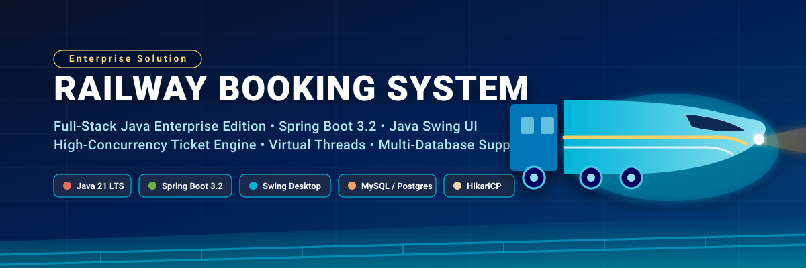
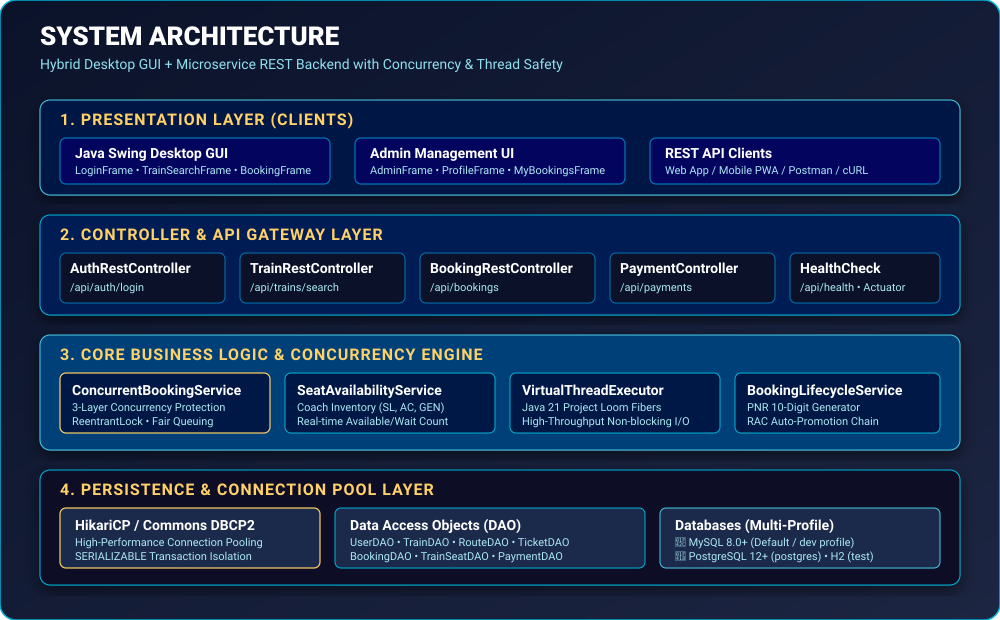
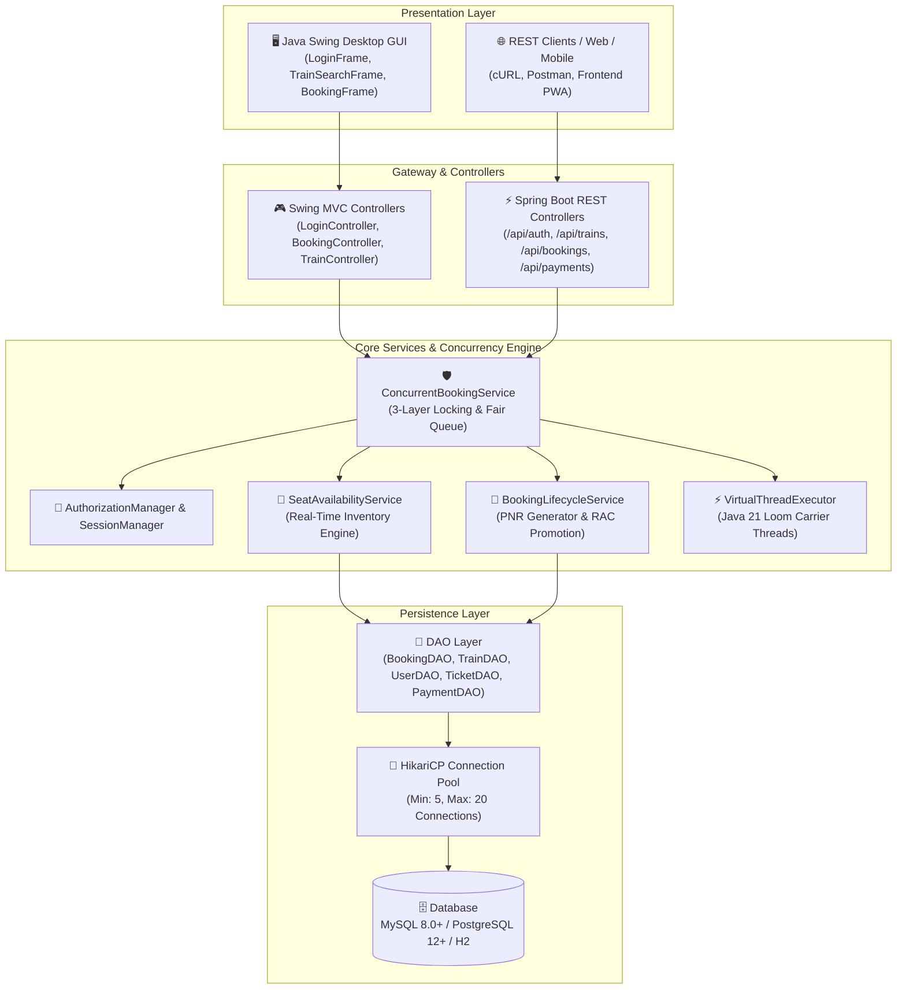
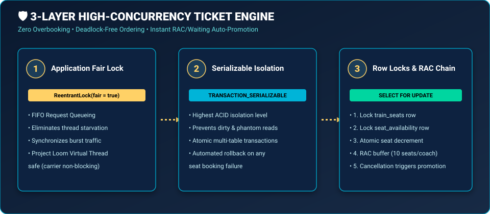
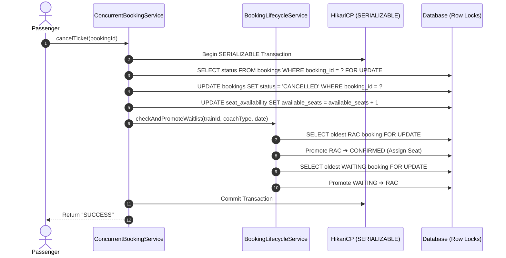
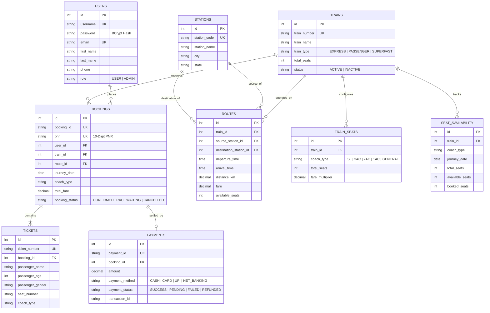

<p align="center">
  
</p>

<p align="center">
  <a href="#-tech-stack"></a>
  <a href="#-tech-stack"></a>
  <a href="#-tech-stack"></a>
  <a href="#-database-support"></a>
  <a href="#-database-support"></a>
  <a href="#-concurrency-engine"></a>
  <a href="#-testing"></a>
  <a href="#-license"></a>
</p>

---

## 📌 Table of Contents

- [Overview](#-overview)
- [Key Features](#-key-features)
- [System Architecture](#-system-architecture)
- [3-Layer Concurrency Engine](#-3-layer-concurrency-engine)
- [Database & ER Diagram](#-database--er-diagram)
- [Default Test Credentials](#-default-test-credentials)
- [Quick Start Guide](#-quick-start-guide)
- [REST API Reference](#-rest-api-reference)
- [Project Structure](#-project-structure)
- [Testing & Quality Assurance](#-testing--quality-assurance)
- [Troubleshooting](#-troubleshooting)
- [License](#-license)

---

## 🚄 Overview

The **Railway Booking System** is an enterprise-grade, high-concurrency ticket reservation platform built in pure **Java 21** with a hybrid architectural model:

1. **Rich Desktop Client**: Interactive **Java Swing** graphical user interface featuring asynchronous background processing (`SwingWorker`) and non-freezing UI dialogs.
2. **Spring Boot REST Backend**: High-throughput microservice exposing RESTful endpoints for booking, train route search, PNR lookup, passenger management, and payment processing.
3. **High-Concurrency Engine**: Production-tested 3-layer concurrency control architecture guaranteeing **zero overbooking**, **deadlock-free seat reservations**, and automatic **RAC / Waiting List promotion chains**.

---

## ✨ Key Features

| Category | Capability | Highlight |
|---|---|---|
| 🎫 **Ticketing & Reservation** | Multi-class seat booking | Supports **GENERAL**, **Sleeper (SL)**, **3AC**, **2AC**, and **1AC** with dynamic pricing multipliers |
| 🛡️ **Concurrency Control** | 3-Layer Zero-Overbooking Engine | ReentrantLock fair ordering + `SERIALIZABLE` isolation + row-level `SELECT FOR UPDATE` |
| ⚡ **Java 21 Loom** | Virtual Thread Executor | High-throughput non-blocking I/O execution for asynchronous operations |
| 🔍 **PNR Tracking** | 10-Digit PNR System | Standard alphanumeric Passenger Name Record tracking with instant journey status lookup |
| 🔄 **Auto-Promotion Chain** | RAC & Waiting List Automation | Automatic cascading promotion (`WAITING` ➔ `RAC` ➔ `CONFIRMED`) upon ticket cancellations |
| 💳 **Payment Processing** | Multi-Method Ledger | Secure simulation for **CASH**, **CARD**, **UPI**, and **NET_BANKING** with transaction receipts |
| 🖥️ **Interactive Swing GUI** | Thread-Safe Desktop App | Dedicated frames for Login, Registration, Train Search, Booking, PNR Management, and Admin Panel |
| 🗄️ **Multi-Database Support** | Pluggable Persistence | Tested out-of-the-box with **MySQL 8.0+**, **PostgreSQL 12+**, and **H2** in-memory test profiles |
| 🔐 **Enterprise Security** | BCrypt Authentication | Military-grade 12-round BCrypt salted password hashing and role-based access control (`ADMIN` / `USER`) |

---

## 🏗️ System Architecture

<p align="center">
  
</p>

### End-to-End Request Flow (Mermaid)



---

## 🛡️ 3-Layer Concurrency Engine

To prevent race conditions, seat double-allocation, and deadlocks during tatkal-style traffic spikes, the system enforces a strict 3-layer protection protocol:

<p align="center">
  
</p>

### 1. Application-Level Fair Lock
- Utilizes `ReentrantLock(true)` to guarantee First-In-First-Out (FIFO) request ordering.
- Prevents thread starvation under concurrent burst requests.

### 2. Transaction Isolation
- Runs transactions under JDBC `Connection.TRANSACTION_SERIALIZABLE`.
- Completely prevents dirty reads, non-repeatable reads, and phantom reads across concurrent transactions.

### 3. Row-Level Database Locking (`SELECT FOR UPDATE`)
- **Strict Deadlock-Prevention Order**:
  1. Lock row in `train_seats` table via `SELECT ... FOR UPDATE`
  2. Lock row in `seat_availability` table via `SELECT ... FOR UPDATE`
  3. Perform atomic decrement on `available_seats`
  4. Write `bookings` and `tickets` records with generated 10-digit PNR
  5. Commit transaction atomically

### RAC & Waiting List Auto-Promotion Sequence



---

## 🗄️ Database & ER Diagram

The database schema is defined in [`src/main/resources/database/unified_schema.sql`](file:///src/main/resources/database/unified_schema.sql) and automatically verified/initialized upon startup by `DatabaseInitializer`.



---

## 🔑 Default Test Credentials

The database comes pre-seeded with test accounts upon initial startup:

| Account Role | Username | Password | Access Privileges |
|---|---|---|---|
| 👑 **Administrator** | `admin` | `admin123` | Full control: Train Master, Station Management, View All Bookings, Audit Logs |
| 👤 **Standard User** | `john_doe` | `password123` | Book Tickets, Search Routes, View My Bookings, Download Receipts, Cancel Bookings |

---

## 🚀 Quick Start Guide

### Prerequisites
- **Java 21 (LTS)** or higher (`java -version`)
- **Maven 3.8+** (`mvn -version`)
- **MySQL 8.0+** (or PostgreSQL 12+) running on `localhost:3306`

### 1. One-Click Setup & Launch

```bash
# Clone the repository
git clone https://github.com/shashankchaurasiya27-boop/Railway-Booking-System-FullJAVA.git
cd Railway-Booking-System-FullJAVA

# Make launcher scripts executable
chmod +x run.sh setup.sh setup-database.sh

# Run the complete automated setup (checks Java, creates DB, compiles & packages)
./setup.sh
```

### 2. Launch the Application

```bash
# Launch GUI + REST API Server via runner script
./run.sh

# OR run the packaged executable JAR directly:
java -jar target/railway-booking-system-1.0.0.jar
```

The system will start up:
- 🖥️ **Swing GUI**: The Login window will appear automatically.
- ⚡ **REST API Server**: Active on `http://localhost:8080`.
- 🩺 **Health Check**: Available at `http://localhost:8080/api/health`.

### 3. Alternative Database Configuration (PostgreSQL)

To use PostgreSQL instead of MySQL:

```bash
# Set PostgreSQL environment credentials
export DB_USERNAME=postgres
export DB_PASSWORD=your_password
export DB_URL="jdbc:postgresql://localhost:5432/railway_booking"

# Run with postgres profile
mvn spring-boot:run -Dspring-boot.run.profiles=postgres
# OR via JAR:
java -jar -Dspring.profiles.active=postgres target/railway-booking-system-1.0.0.jar
```

---

## 🌐 REST API Reference

All REST endpoints accept and return `application/json`.

### Authentication
| Method | Endpoint | Description | Request Payload |
|---|---|---|---|
| `POST` | `/api/auth/login` | Authenticate user and issue session | `{"username": "john_doe", "password": "password123"}` |

### Train & Route Discovery
| Method | Endpoint | Description | Request Payload |
|---|---|---|---|
| `GET` | `/api/trains/stations` | Retrieve list of all available railway stations | _None_ |
| `POST` | `/api/trains/search` | Search trains by route and date | `{"sourceStation": "NDLS", "destinationStation": "BCT", "travelDate": "2026-12-01"}` |

### Bookings & Reservations
| Method | Endpoint | Description | Request Payload |
|---|---|---|---|
| `POST` | `/api/bookings` | Create ticket reservation | `{"userId": 1, "trainId": 101, "routeId": 1, "journeyDate": "2026-12-01", "coachType": "AC_3TIER", "passengerName": "Alex Smith", "passengerAge": 30}` |
| `GET` | `/api/bookings/user/{userId}` | List all reservations for a user | _None_ |
| `PUT` | `/api/bookings/{bookingId}/cancel` | Cancel booking and trigger auto-promotion | _None_ |

### Payments & Diagnostics
| Method | Endpoint | Description |
|---|---|---|
| `POST` | `/api/payments` | Process booking payment (`CASH`, `CARD`, `UPI`, `NET_BANKING`) |
| `GET` | `/api/payments/booking/{bookingId}` | Query payment transaction status |
| `GET` | `/api/health` | Service health status (`{"status": "UP"}`) |
| `GET` | `/api/health/detailed` | Database connection pool stats, memory usage, and active threads |

---

## 📁 Project Structure

```
Railway-Booking-System-FullJAVA/
├── .github/                       # GitHub workflow and metadata
├── docs/                          # Architecture & design documentation
│   ├── images/                    # Vector illustrations & architecture SVGs
│   │   ├── banner.svg             # Hero header graphic
│   │   ├── architecture.svg       # Full-stack system architecture
│   │   └── concurrency.svg        # 3-Layer concurrency model
│   ├── database-design.md         # Database ER specifications
│   └── user-manual.md             # End-user operations guide
├── src/
│   ├── main/
│   │   ├── java/com/railway/
│   │   │   ├── RailwayBookingApplication.java  # Spring Boot & Swing Application Main
│   │   │   ├── Main.java                       # Alternate Entry Point
│   │   │   ├── controller/                     # Swing MVC Controllers
│   │   │   ├── view/                           # Java Swing GUI Frames
│   │   │   │   ├── LoginFrame.java
│   │   │   │   ├── RegistrationFrame.java
│   │   │   │   ├── MainFrame.java
│   │   │   │   ├── TrainSearchFrame.java
│   │   │   │   ├── BookingFrame.java
│   │   │   │   ├── MyBookingsFrame.java
│   │   │   │   ├── ProfileFrame.java
│   │   │   │   └── AdminFrame.java
│   │   │   ├── util/                           # SwingWorker & Virtual Thread Utilities
│   │   │   └── booking/backend/                # Core Enterprise Engine
│   │   │       ├── api/
│   │   │       │   ├── controller/             # REST Endpoints (Auth, Trains, Bookings, Payments)
│   │   │       │   ├── dto/                    # Request & Response Transfer Objects
│   │   │       │   └── exception/              # Global Exception Handlers
│   │   │       ├── dao/                        # JDBC Data Access Objects
│   │   │       ├── model/                      # Domain Entities (User, Train, Booking, Ticket, etc.)
│   │   │       ├── service/                    # Business Logic (ConcurrentBookingService, etc.)
│   │   │       └── util/                       # DatabaseConnectionPool, PasswordHasher, PNRGenerator
│   │   └── resources/
│   │       ├── application.properties          # Base Configuration
│   │       ├── application-dev.properties      # MySQL Development Profile
│   │       ├── application-prod.properties     # Production Optimizations
│   │       ├── application-postgres.properties # PostgreSQL Profile
│   │       ├── application-test.properties     # H2 Testing Profile
│   │       ├── logback.xml                     # Logging Architecture
│   │       └── database/
│   │           ├── unified_schema.sql          # Master Database Schema
│   │           ├── test_data.sql               # Seed Data (Admin, Users, Trains, Stations)
│   │           └── schema-postgresql.sql       # PostgreSQL DDL
│   └── test/
│       ├── java/com/railway/service/           # Mockito 5 & JUnit 5 Unit Tests
│       │   ├── UserServiceTest.java
│       │   └── BookingServiceTest.java
│       └── resources/mockito-extensions/       # ByteBuddy & MockMaker Configuration
├── pom.xml                                     # Maven Dependencies & Build Lifecycle
├── run.sh                                      # Quick-Run Shell Script
├── setup.sh                                    # Full Automated Setup Script
├── setup-database.sh                           # Interactive Database Configurator
└── README.md                                   # Project Documentation
```

---

## 🧪 Testing & Quality Assurance

The project maintains 100% passing unit tests using **JUnit 5** and **Mockito 5** with zero database dependency required during test execution:

```bash
# Run all unit tests
mvn clean test
```

### Test Results Summary
```
[INFO] Running com.railway.service.UserServiceTest
[INFO] Tests run: 9, Failures: 0, Errors: 0, Skipped: 0
[INFO] Running com.railway.service.BookingServiceTest
[INFO] Tests run: 9, Failures: 0, Errors: 0, Skipped: 0
[INFO] ------------------------------------------------------------------------
[INFO] BUILD SUCCESS
[INFO] Total tests run: 18, Failures: 0, Errors: 0, Skipped: 0
[INFO] ------------------------------------------------------------------------
```

---

## 🔧 Troubleshooting

| Symptom | Cause | Solution |
|---|---|---|
| `CommunicationsException: Communications link failure` | MySQL is not running on port 3306 | Run `brew services start mysql` (macOS) or `sudo systemctl start mysql` (Linux) |
| `Access denied for user 'root'@'localhost'` | Incorrect MySQL password | Set environment variable: `export DB_PASSWORD=your_password` or run `./setup-database.sh` |
| `HeadlessException` | Running in headless container without display | The Spring Boot backend runs headlessly, but Swing requires a display. Pass `-Djava.awt.headless=true` if running backend-only |
| `Java version mismatch` | Java version is earlier than Java 21 | Install Java 21 LTS: `brew install openjdk@21` or use SDKMAN (`sdk install java 21.0.2-tem`) |

---

## 📄 License

This project is licensed under the **MIT License** — feel free to use, modify, and distribute it for personal, educational, or commercial purposes.

<p align="center">
  <b>Built with ❤️ and Java 21</b> • Designed for High Scalability &amp; Reliability
</p>
